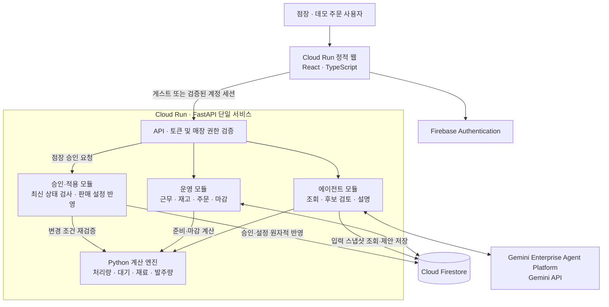

# ShiftPatch 아키텍처 및 기술 스택 설계

> 개인 카페의 근무 인력·숙련도·재고·주문 흐름을 함께 읽고, 당일 판매 전략과 다음날 준비를 제안하는 운영 에이전트.

- 작성일: 2026-10-04
- 기준: 2인 개발, 14일 MVP, 일본 개인 카페 1개
- 상태: 목표 설계와 구현 결정. 2026-10-11 사용자별 샘플 체험·게스트 세션·Firebase 로그인 연결·Firestore 저장·Cloud Run 배포 코드를 구현했다. 실제 클라우드 배포·인증·모델 호출은 프로젝트 설정 후 검증해야 한다. 현재 범위는 [README.md](README.md), 사용자 준비 항목은 [docs/USER_SETUP.md](docs/USER_SETUP.md), 에이전트 구현은 [docs/AGENT_IMPLEMENTATION.md](docs/AGENT_IMPLEMENTATION.md)에 기록한다. 2026-10-11 후속 구현으로 사건별 자동 요청·진행 단계·질문 답변 연결·로트별 FIFO·시간대별 수요·실호출 검증 명령을 추가했다. 이 문서의 POS·발주처 연동 등 장기 범위와 실제 클라우드 검증 완료를 의미하지는 않는다.
- 반영 자료: ShiftPatch 기획서 및 사용자가 제공한 해커톤 개발 프로젝트 조건

## 1. 설계 결정

**React 웹 + Cloud Run의 FastAPI 서버 + Gemini Enterprise Agent Platform 경유 Gemini API + Firestore**로 구성한다.

백엔드는 하나의 서비스로 배포하고, 내부 코드를 운영·계산·에이전트·승인 모듈로 나눈다. 일반 앱은 사실과 실행 결과를 저장하고, Python 계산 엔진은 수량·시간·금액을 계산하며, Gemini는 상황에 맞는 조회와 후보 검토·설명을 담당한다.

제품의 핵심 연결은 다음과 같다.

```text
근무·재고·주문 입력
  → 현재 조건으로 운영 후보 계산
  → 점장 선택·승인
  → 실제 신규 주문 접수 규칙 변경
  → 마감 실적과 당시 예측 비교
  → 다음날 준비·발주 후보 갱신
```

## 2. 해커톤 조건 대응

사용자가 제공한 조건은 실행 제품 목록에서 1개 이상, AI 기술 목록에서 1개 이상을 사용해야 한다는 의미다. Flutter와 Firebase는 선택 기술이며, 이번 설계에서는 Firebase를 사용한다.

| 구분 | 선택 제품 | ShiftPatch에서 실제로 수행할 역할 | 제출 시 확인할 증거 |
| --- | --- | --- | --- |
| 필수: Google Cloud 애플리케이션 실행 | **Cloud Run** | FastAPI API, 계산 엔진, 에이전트 실행 | 배포 서비스·리비전, API 호출 기록, 동작 화면 |
| 필수: Google Cloud AI | **Gemini API — Gemini Enterprise Agent Platform 경유** | 운영 데이터 조회 도구 선택, 운영안 비교, 근거·마감 피드백 생성 | 서버의 모델 호출 코드, 사용 모델·호출 기록, 상황별 결과 |
| 웹 제공 | **Cloud Run** | React 정적 웹과 API를 같은 서비스에서 제공 | 공개 URL 및 정적 웹/API 동작 |
| 선택: Firebase | **Firebase Authentication** | 점장 로그인 | 로그인 흐름 및 서버 토큰 검증 |
| 선택: Firebase | **Cloud Firestore** | 운영 데이터, 재료 예약, 제안·적용 이력 저장 | 데이터 구조와 트랜잭션 구현 |

공식 제품명은 **Gemini Enterprise Agent Platform(구 Vertex AI)**로 표기한다. SDK·설정·문서 경로에 남아 있는 `Vertex AI` 명칭은 해당 플랫폼의 호출 경로를 설명할 때 병기한다. [공식 제품 소개](https://cloud.google.com/products/gemini-enterprise-agent-platform)

AI 호출은 Cloud Run 서버에서 Google Cloud 프로젝트의 플랫폼 경유로 실행한다. 애플리케이션 실행 장소는 Cloud Run이며, 플랫폼의 별도 에이전트 호스팅이나 ADK 도입은 이번 필수 조건을 충족하기 위한 전제는 아니다. [플랫폼 시작 가이드](https://docs.cloud.google.com/gemini-enterprise-agent-platform/models/start)

제출 설명 초안은 다음과 같다. 실제 구현·배포 후 확인된 내용으로 확정한다.

> ShiftPatch는 Cloud Run에서 웹·운영 API·Python 시뮬레이션 엔진을 실행하고, Gemini Enterprise Agent Platform 경유 Gemini API로 인력·재고·주문 상황에 맞는 운영안을 제안합니다. 방문자마다 샘플 매장을 제공하며 Firebase Authentication과 Firestore로 선택적 Google 로그인, 운영 기록과 승인 이력을 관리합니다.

## 3. MVP 범위

| 항목 | 구현 범위 |
| --- | --- |
| 매장·운영 구간 | 카페 1개, 2시간 영업 시나리오 |
| 직원·메뉴·재료 | 직원 4명, 메뉴 6개, 원재료 최대 8종, 작업대 2개 |
| 점장 화면 | 근무, 준비, 영업, 마감의 4개 화면 |
| 직원 정보 | 점장이 가능일·숙련도·확정 근무를 입력·수정 |
| 주문 입력 | 별도 데모 주문 화면에서 실제 API로 주문 접수 |
| AI 제안 | 영업 전 준비, 결원·재료 부족 대응, 마감 후 다음날 준비 |
| 운영 후보 | 기본 3개, 최대 5개 비교 |
| 과거 기록 | 최근 7개 영업일 합성 데이터, 화면에서 수정 가능 |
| 실제 저장 | 데모 중 접수·완료 주문, 재고 변화, 승인·판매 제한, 마감 기록 |

직원 전용 화면, 월간 시프트 자동 편성, 실제 POS·배달앱·LINE·발주처 연동, 결제·환불, 강화학습은 후속 범위다. 대타 모집 문구는 복사용으로 제공할 수 있다.

## 4. 전체 아키텍처



브라우저는 FastAPI를 통해 운영 데이터에 접근한다. Firestore 직접 접근을 막고, 주문·재고·판매 설정 변경 경로를 서버로 통일한다. Gemini는 서버가 허용한 도구만 호출하며, 판매 설정 적용은 점장 승인 API가 담당한다.

계산 엔진은 DB나 모델에 직접 의존하지 않는다. 입력 스냅샷과 후보를 받아 결과를 반환하는 Python 모듈로 만들어, 같은 입력으로 반복 검증할 수 있게 한다.

## 5. 기술 스택과 선택 이유

| 영역 | 선택 | 역할·선택 이유 |
| --- | --- | --- |
| 웹 | React + TypeScript + Vite | 점장 운영 화면과 데모 주문 화면을 하나의 웹 프로젝트로 구현 |
| UI | 자체 CSS + Lucide | 화이트·네이비 표·폼·모달·후보 비교 화면 구성 |
| 서버 상태 | TanStack Query | 조회, 재조회, 변경 후 갱신, 로딩·실패 처리 |
| API | Python + FastAPI + Pydantic | API 입력 검증, 응답 형식, 계산·AI 코드 통합 |
| AI SDK | Google Gen AI SDK for Python | 플랫폼 경유 Gemini 호출과 함수 호출 연결 |
| 모델 | 함수 호출·구조화 출력을 지원하는 Gemini Flash 계열 후보 | 평가 상황으로 품질·응답 시간을 확인한 뒤 모델 ID 고정 |
| 계산 | Python 표준 라이브러리 중심의 이벤트 시뮬레이터 | 직원·작업대 배정과 후보별 결과를 재현 가능하게 구현 |
| 저장 | 로컬 SQLite / 공개 Firestore | 사용자별 샘플 운영 기록과 원자적 상태 변경 |
| 인증 | Firebase Authentication | 로그인과 ID 토큰 발급 |
| 실행 | Cloud Run + Docker | API·계산·에이전트 통합 실행 |
| 웹 배포 | Cloud Run | React 정적 웹과 API를 같은 Origin에서 제공 |
| 검증 | pytest + Playwright | 계산·트랜잭션 검증 및 핵심 사용자 흐름 재현 |
| 로그 | Cloud Logging | 요청·모델 호출·승인·실패 추적 |

TanStack Query는 서버 상태 관리에, FastAPI는 입력 검증과 API 문서 생성에 활용한다. [TanStack Query 문서](https://tanstack.com/query/latest/docs/framework/react/overview), [FastAPI 문서](https://fastapi.tiangolo.com/features/)

MVP에서는 별도 메시지 브로커, 벡터 DB, 다중 에이전트, 마이크로서비스를 도입하지 않는다. 현재 판단에 필요한 데이터는 구조화된 운영 기록이며, 서버의 조회·계산 함수로 제공한다.

Firestore는 기획의 Google Cloud 구성과 제한된 매장 규모를 기준으로 선택한다. 다매장 재고 이동·복잡한 정산·집계 요구가 생기면 PostgreSQL 전환을 검토하되, 14일 MVP 중에는 DB 선택을 변경하지 않는다.

## 6. 모듈과 AI 도구

| 모듈 | 책임 |
| --- | --- |
| `operations` | 시프트·숙련도·입고·주문·재고·마감 처리 |
| `simulation` | 작업 배정, 대기·완료·미완료·제한 수량 계산 |
| `planning` | 기준 판매량, 준비량·발주량, 예상/실제 비교 |
| `agent` | 사건별 조회, 부족한 정보 확인, 계산 도구 호출, 근거 설명 |
| `approval` | 점장 권한·제안 버전 검사, 판매 설정 적용 |
| `repositories` | Firestore 읽기·쓰기와 트랜잭션 |
| `clock` | 실제 시각 또는 데모 영업 시각 제공 |

### 6.1 에이전트 흐름

```text
결원·재료 부족·주문 적체 감지 또는 점장 요청
  → 일관된 입력 스냅샷 생성
  → 관련 근무·숙련도·재고·주문 조회
  → 부족한 조건이 있으면 확인 요청
  → 허용된 판매 조정 범위에서 후보 구성
  → 계산 엔진으로 검증·시뮬레이션
  → 수치가 연결된 후보와 추천 이유 저장
  → 점장 화면에서 승인 API 요청
  → 현재 판매 설정 재조회로 반영 확인
```

영업 중에는 결원 입력·실재고 수정·대기 임계값 초과 같은 사건에서 재계산을 제안한다. 매 주문마다 모델을 호출하지 않고, 동일 상태의 중복 실행을 합친다. 영업 전과 마감 후에는 화면의 명시적 실행으로 시작한다.

| 도구 | 입력·출력 요약 |
| --- | --- |
| `read_shift` | 스냅샷 기준 실제 근무자·근무 시간·결원 조회 |
| `read_staff_menu_times` | 해당 직원의 메뉴 가능 여부·준비 시간 조회 |
| `read_inventory` | 사용 가능한 로트·예약량·예정 입고 조회 |
| `read_queue` | 접수·준비 중 주문과 기존 작업 잔여 시간 조회 |
| `estimate_sales` | 과거 판매·제한 이력으로 시간대별 기준 수량 계산 |
| `calculate_prep` | 대상 영업일의 판매 기준·근무·재고로 준비 가능량과 부족량 계산 |
| `simulate_service_plan` | 스냅샷·후보·시드로 시간·처리량·재료·판매금액 계산 |
| `read_close_record` | 확정된 마감 실적과 당시 제안·제한 이력 조회 |
| `calculate_next_day_prep` | 다음날 필요 재료·재고·확정 입고로 준비·발주 후보 계산 |
| `compare_plan_actual` | 같은 구간의 예상·실적·운영 변경 비교 |
| `read_current_mode` | 계산 스냅샷에 담긴 판매 설정과 재확인 상태 조회 |

계산 중 모든 조회 도구는 같은 `snapshot_id`를 사용한다. 도구별로 서로 다른 시점의 데이터를 읽어 하나의 계산에 섞지 않는다. 승인 후 반영 확인은 에이전트의 스냅샷 조회와 별개로 승인 모듈이 현재 설정을 실조회한다. `store_id`와 사용자 권한은 서버가 결정하며 모델 인자를 신뢰하지 않는다.

판매 설정 승인·반영은 영업 중 `service_plan`에만 해당한다. 영업 전·마감 후 준비 후보는 점장이 확인·기록하며 실제 발주나 판매 설정을 변경하지 않는다. 상세 실행 규칙은 7장에서 정의한다.

함수 호출에는 플랫폼의 Gemini 도구 호출 기능을 사용한다. 최종 설명은 구조화된 결과로 받고 서버에서 필드와 참조 ID를 검증한다. 수량·시간·금액은 계산 결과에서 화면으로 직접 전달한다. [함수 호출 문서](https://docs.cloud.google.com/gemini-enterprise-agent-platform/models/tools/function-calling), [구조화 출력 문서](https://docs.cloud.google.com/gemini-enterprise-agent-platform/models/capabilities/control-generated-output)

### 6.2 실패와 실행 한도

- 후보는 기본 3개, 최대 5개로 제한하고 도구 실행 회수·응답 크기·전체 시간에 상한을 둔다.
- 모델 실패 시 기본 운영 화면을 유지하고, 실패한 제안과 재시도 여부를 표시한다.
- 계산 결과가 있는 경우 AI 설명 없이 결과표를 표시할 수 있으며, AI 제안과 구분한다.
- 모델이 저장된 후보 ID·계산 결과에 없는 내용을 반환하면 적용 가능한 제안으로 저장하지 않는다.
- 판매 변경 함수는 모델에 직접 노출하지 않는다. 점장의 인증된 승인 요청으로만 실행한다.

## 7. 에이전트 모듈 상세 설계

### 7.1 구현 방식과 책임 경계

MVP는 **Google Gen AI SDK를 사용하는 단일 에이전트와 서버의 명시적인 실행 루프**로 구현한다. 영업 전·중·후는 같은 에이전트의 실행 모드로 구분한다. ADK나 별도 에이전트 서버는 필수 의존성으로 추가하지 않는다.

모델은 필요한 조회·계산 도구와 운영 후보를 선택한다. 실제 실행 여부, 실행 가능한 인자, 결과 저장과 상태 전이는 서버 코드가 결정한다. 모델 함수 호출을 SDK에서 제한 없이 자동 실행하도록 구성하지 않고, 도구 Dispatcher를 거치게 한다.

| 구성 요소 | 결정·수행하는 것 | 경계 |
| --- | --- | --- |
| Gemini | 어떤 정보를 더 볼지, 허용 범위 안의 후보, 점장 우선순위에 맞는 추천·설명 | 재고·금액·대기 시간과 권한을 직접 결정하지 않음 |
| 실행기 `runner` | 모드·시간 예산·허용 전이 검사, 모델이 요청한 도구 실행·결과 반환, 종료 조건 관리 | 상황별 조회 순서·대안·수정 여부를 미리 결정하지 않으며 점장 승인을 대신하지 않음 |
| 도구 Dispatcher | 허용 도구, 인자 형식·범위, 고정 스냅샷, 도구 결과 연결 | 임의 SQL·Python·HTTP 실행을 제공하지 않음 |
| 계산 엔진 | 제약 검증, 준비량·시뮬레이션·발주량·오차 | 모델 문장을 계산 근거로 사용하지 않음 |
| 결과 검증기 | 후보·근거·계산 결과 참조, 추천 가능 여부, 최신성 | 검증 실패 결과를 적용 가능한 제안으로 저장하지 않음 |
| 승인 모듈 | 점장 인증, 선택 후보 재검증, 판매 설정 반영 | 모델 도구 목록에 포함하지 않음 |

에이전트의 자율성은 사건에 맞게 자료를 조회하고 후보를 비교하는 과정에서 보여준다. 예를 들어 결원에는 직원별 메뉴 준비 시간을, 입고 불일치에는 실제 로트와 레시피를 먼저 조사한다. 실행 경로가 달라도 같은 운영 제약과 승인 규칙을 따른다.

**Gemini가 상황에 따라 조회 대상·순서와 후보 조건을 선택하고, 도구 결과를 받아 추가 조회·후보 수정·종료 중 다음 행동을 다시 결정하는 것을 필수 구현 요건으로 둔다.** 모든 조회와 후보 계산을 코드가 고정한 뒤 Gemini가 설명만 작성하는 구성은 이 요건을 충족하지 않는다. 구체적인 검증 기준은 7.13에서 정의한다.

### 7.2 세 가지 실행 모드

| 모드 | 시작 조건 | 필수 근거·도구 | 저장 결과·후속 행동 |
| --- | --- | --- | --- |
| `pre_open` | 점장이 대상 영업일의 준비 제안 요청 | 근무·숙련도·실재고·확정 입고, `estimate_sales`, `calculate_prep` | `prep_plan`: 준비 가능량·부족량·추가 준비 후보를 확인·기록 |
| `in_service` | 결원·재고 변경·주문 적체 또는 점장 요청 | 현재 근무·숙련도·기존 주문·예약 재고·판매 설정, `simulate_service_plan` | `service_plan`: 후보를 비교하고 별도 승인 API로 적용 |
| `post_close` | 확정 마감 후 다음 영업일 준비 요청 | `read_close_record`, `compare_plan_actual`, 다음날 근무·재고·입고, 보정된 기록의 `estimate_sales`, `calculate_next_day_prep` | `next_day_plan`: 오차 근거와 다음날 준비·발주 후보를 확인·기록 |

마감이 확정되지 않았다면 `post_close`의 실적 보정 결과를 확정 제안으로 만들지 않는다. 다음날 시프트처럼 필요한 사실이 없으면 해당 항목을 확인 요청으로 반환한다. 판매 제한 설정 API는 `service_plan`만 허용한다.

자동 재계산의 MVP 범위는 **화면이 열려 있는 동안 사건을 감지하고 제안 생성을 요청하는 것**까지다. 운영 API는 사건을 기록하고 `replan_required`를 표시하며, 웹이 사건 키를 포함해 제안 API를 호출한다. 사용자가 화면을 닫은 뒤에도 지속 실행하는 기능은 내구성 있는 작업 큐 도입 후 확장한다.

대기열 임계값은 초과 상태로 바뀔 때 사건을 만들고, 계속 초과 중인 매 주문마다 새 사건을 만들지 않는다. 같은 사건의 중복 요청은 같은 실행 결과를 참조한다.

### 7.3 요청과 서버 실행 컨텍스트

`POST /api/stores/{id}/proposals`의 요청 형식 예시는 다음과 같다. 아래 ID·날짜는 형식 설명용이며 실행 결과가 아니다.

```json
{
  "mode": "in_service",
  "trigger_event_id": "event-staff-absence-001",
  "service_date": "2026-10-04",
  "objective": "preserve_drinks",
  "constraints": {
    "allowed_review_minutes": [15, 30],
    "allow_menu_pause": true
  },
  "locale": "ja-JP"
}
```

`objective`는 `balanced`, `preserve_drinks`, `reduce_delay` 같은 화면 선택값으로 제한한다. 기존 주문 보존과 재고·직원 제약은 모든 목표에 공통으로 적용한다. 요청의 제약도 서버가 허용한 범위 안인지 검사한다. 호출자·역할·스냅샷은 요청 본문에서 받지 않는다.

| 컨텍스트 필드 | 서버가 고정하는 값 |
| --- | --- |
| `run_id`, `request_id` | 실행·요청 식별자 |
| `store_id`, `actor_id`, `role` | 인증된 사용자와 매장 권한 |
| `mode`, `objective`, `constraints` | 검증된 실행 모드와 점장 선택 |
| `snapshot_id`, `state_revision` | 이번 계산에 사용할 불변 입력과 운영 버전 |
| `as_of_business_time`, `service_window` | 계산 기준 영업 시각과 평가 구간 |
| `real_deadline` | 실제 경과 시간 기준 실행 종료 시점 |
| `scenario_id`, `random_seed` | 후보들이 공유할 신규 주문 유입 가정 |
| `model_id`, `prompt_version`, `engine_version` | 재현·평가용 버전 |
| `parent_run_id` | 확인 답변이나 재계산으로 이어진 이전 실행 |

스냅샷에는 해당 모드에 필요한 메뉴·레시피·직원·주문·재고·과거 판매·다음날 조건을 함께 고정한다. 모델의 추가 조회는 이 안에서 자료를 선택하는 작업이다. 스냅샷에 없는 최신 정보를 중간에 섞지 않는다.

서버의 스냅샷 확보와 모델의 조사는 구분한다. 첫 모델 요청에는 사건·목표·기본 요약·조회 가능한 자료를 전달하고, 세부 작업 시간·로트·주문 항목은 선택한 도구로 확인하게 한다. 서버가 일관성을 위해 자료를 확보했다고 해서 모든 도구를 미리 실행하거나 모든 판단 근거를 한 번에 모델에 주입하는 구조로 만들지 않는다. 이미 전달한 근거를 보여주기 위해 의미 없는 조회를 반복시키지도 않는다.

입력 스냅샷 생성은 매장 규모에 맞게 짧은 읽기 트랜잭션으로 처리한다. 이후 모델과 계산 도구는 저장된 스냅샷을 사용한다. `agentRuns`, `snapshots`, `proposals` 기록 자체는 운영 `state_revision`을 증가시키지 않는다. 주문·재고·근무·판매 설정 등 계산 입력을 바꾸는 작업만 버전을 증가시킨다.

### 7.4 한 번의 실행 순서

1. **요청 검증:** 사용자 권한·실행 모드·중복 방지 키를 확인하고 `agentRuns`에 실행을 등록한다.
2. **스냅샷 준비:** 필요한 사실을 일관된 버전으로 읽고, 필수 입력 누락을 코드로 먼저 검사한다.
3. **상황 조사:** Gemini에 사건·점장 목표·데이터 요약·허용 도구를 전달한다. 모델은 필요한 상세 조회를 선택한다.
4. **도구 실행:** Dispatcher가 함수 이름과 인자를 검사하고 결과를 모델에 전달한다. 같은 스냅샷을 읽는 독립 조회는 병렬로 실행할 수 있다.
5. **후보 계산:** 모델이 허용된 후보를 구성하면 서버가 정규화·검증하고 계산 엔진을 호출한다. 영업 중에는 현재 설정 기준 결과도 항상 포함한다.
6. **추천 설명:** 모델은 계산된 후보 ID와 근거 ID를 참조해 추천·차이·주의 조건을 작성한다.
7. **최종 검증·저장:** 결과 참조와 현재 운영 버전·유효 시간을 검사하고 제안과 실행 결과를 저장한다.
8. **응답 종료:** 웹에 실행 상태와 제안을 반환한다. 점장 승인이나 추가 답변을 기다리며 HTTP 요청을 유지하지 않는다.

위 번호는 책임을 설명한 것이며 한 번씩만 거치는 고정 파이프라인이 아니다. **3~6단계는 도구 결과에 따라 순환**한다. 모델이 추가 조회를 요청하면 조사로, 후보를 수정해 계산을 요청하면 계산으로 돌아간다. 후보 검증 실패뿐 아니라, 실행 가능한 후보라도 점장 목표에 비해 대기·거절량 등의 손해가 크면 다른 조건을 시험할 수 있다. 서버는 상한·권한·선행 결과의 존재를 검사하며 다음 조사 대상이나 수정 수량을 대신 선택하지 않는다.

함수 호출과 함수 결과는 SDK가 요구하는 대응 관계와 대화 객체를 보존해 다음 모델 요청에 전달한다. 모델이 함수를 요청했다는 사실만으로 실행 성공을 표시하지 않는다. 도구 실행 결과가 성공한 뒤 다음 단계로 넘어간다.

생성 도중 운영 입력이 바뀌면 계산 결과를 과거 스냅샷의 결과로 보관하고 `stale`로 반환한다. 승인 가능한 새 결과를 얻으려면 새 실행을 시작한다. 생성 완료 시점 검사와 승인 직전 검사는 모두 필요하다.

### 7.5 실행 상태와 제안 상태

`AgentRun.status`는 요청 실행 상태이고, `Proposal.status`는 결과를 사용·적용할 수 있는 상태다. 두 값을 분리한다.

| 실행 상태 | 의미·다음 행동 |
| --- | --- |
| `running` | 조사·계산·설명 중. `phase`로 세부 단계 표시 |
| `waiting_input` | 필수 사실·선호 확인이 필요해 이번 요청 종료 |
| `succeeded` | 검증된 결과 저장 완료. 판매 설정 적용을 의미하지 않음 |
| `stale` | 결과 저장 시 이미 입력 버전·유효 조건이 변경됨 |
| `failed` | 도구·모델·결과 검증 실패 |
| `timed_out` | 전체 실제 시간 예산 초과 |
| `interrupted` | 요청 또는 인스턴스 중단으로 완료되지 않은 실행 |

`phase`는 `snapshot`, `investigate`, `calculate`, `explain`, `validate` 중 현재 작업으로 기록한다. `investigate`·`calculate`·`explain` 사이의 재진입을 허용하며, 고정 순서대로 한 번씩 진행하도록 강제하지 않는다. 진행 표시는 확인된 단계만 보여주며 모델의 내부 사고 과정을 표시하지 않는다.

| 제안 상태 | 의미 |
| --- | --- |
| `ready` | 현재 조건 기준으로 확인·선택 가능한 결과 |
| `applied` | `service_plan`을 점장이 승인해 판매 설정까지 반영 |
| `acknowledged` | 준비·다음날 계획을 점장이 확인·기록 |
| `stale` | 새 상태로 다시 계산해야 하는 결과 |
| `dismissed` | 점장이 사용하지 않기로 한 결과 |

생성 당시 `succeeded`였던 실행은 이후에도 과거 실행 기록으로 남는다. 그 뒤 조건이 바뀌면 아직 선택하지 않은 `ready` 제안을 `stale`로 판단한다. `applied`·`acknowledged`는 당시 적용·확인 이력으로 유지하며, 승인 자체가 운영 버전을 올렸다는 이유로 다시 만료시키지 않는다. 현재 판매 설정의 검토 상태는 제안 이력과 별도로 관리한다. 승인 API는 상태 문자열만 믿지 않고 현재 버전과 적용 시간을 다시 검사한다.

`waiting_input`의 답변은 새 요청이다. 근무·재고 같은 사실 수정은 정식 운영 API로 먼저 저장하고, 새 스냅샷·새 `run_id`로 실행한다. 선호 답변은 검증 후 새 실행 옵션에 넣는다. `parent_run_id`로 이전 질문을 연결하며, 모델 대화에만 사실 변경을 남기지 않는다.

### 7.6 도구 입출력 계약

모델이 지정하는 것은 업무상 필요한 필터와 후보 조건이다. 매장·권한·스냅샷·시드는 Dispatcher가 실행 컨텍스트에서 주입한다. 도구 인자에 없는 필드는 거부하고, 실제 메뉴·직원 ID가 해당 스냅샷 안에 존재하는지 확인한다.

| 도구 | 모델이 전달 가능한 인자 | 결과의 주요 내용 |
| --- | --- | --- |
| `read_shift` | 대상 영업일 | 확정 근무·결원·업무 가능 시간 |
| `read_staff_menu_times` | 직원 ID·메뉴 ID 필터 | 가능 여부·메뉴별 준비 시간·누락 항목 |
| `read_inventory` | 재료 ID 필터 | 로트·예약·유효성·실입고와 예정 입고 구분 |
| `read_queue` | 필요한 주문 상태 필터 | 기존 주문·작업 배정·경과 시간·영향 주문 |
| `read_current_mode` | 없음 | 스냅샷 당시 판매 제한·남은 한도·검토 시각 |
| `estimate_sales` | 스냅샷에 포함된 대상 영업일·시간대 | 기준 수량·사용 표본·제한 구간·근거 부족 여부 |
| `calculate_prep` | 같은 실행의 판매 기준 결과 ID | 근무·레시피·재고를 반영한 준비 가능량·부족량 |
| `simulate_service_plan` | 허용된 `candidate_spec` | 후보 ID·실행 가능 여부·수치·제약 위반·영향 주문 |
| `read_close_record` | 스냅샷에 고정된 마감 기록 ID | 확정 실적·실재고·제한 이력·당시 제안 |
| `compare_plan_actual` | 해당 마감과 연결된 제안 ID | 같은 구간의 오차·조건 차이·관측 제한 |
| `calculate_next_day_prep` | 다음 영업일·같은 실행의 판매 기준 결과 ID | 필요량·가용 재고·확정 입고·추가 발주 후보 |

점장 지정 여유 재고량은 저장된 설정을 사용한다. AI가 임의로 여유분을 늘려 발주 후보를 바꾸지 않는다. 다른 실행의 결과 ID도 입력으로 사용할 수 없으며, 필요한 과거 제안은 스냅샷의 명시적인 참조로만 제공한다.

도구 응답의 공통 형식은 다음과 같이 정의한다. 이는 애플리케이션 내부 계약이며 SDK 응답 형식과는 별개다.

```text
ToolResult
  call_id            모델 함수 호출과 연결하는 ID
  tool_name          실제 실행한 도구
  status             ok | needs_input | invalid_candidate | error
  snapshot_id        계산 입력의 출처
  result_id          서버가 부여한 결과 ID
  data               검증된 조회·계산 결과
  evidence_refs[]    직원·재료·주문·기록에 대한 근거 참조
  warnings[]         입력 부족·기존 주문 이행 위험·수요 관측 제한
  error              오류 코드, 수정 가능한 필드, 재시도 가능 여부
```

같은 실행에서 같은 도구와 정규화된 인자를 반복 요청하면 저장된 결과를 재사용한다. 새로운 사실이 필요하면 현재 실행을 끝내고 새 스냅샷으로 시작한다. 도구 결과를 비워 두거나 실패를 0개·0분으로 바꾸지 않는다.

### 7.7 후보 생성·비교·추천 규칙

영업 중 `candidate_spec`은 아래 범위로 제한한다.

```text
CandidateSpec
  action                  keep_current | replace_limits
  review_after_minutes    점장이 허용한 검토 간격
  menu_limits[]
    menu_id               등록 메뉴 ID
    max_new_units         새 적용 구간에 추가 접수할 수량, 0은 판매 중지
```

비교 기준인 `keep_current`는 서버가 직접 만든다. 모델은 기본 두 개의 대안을 제안하고 전체 후보 수를 최대 5개로 제한한다. 같은 제한 조합은 중복 제거한다. `replace_limits`에는 모든 메뉴의 제한을 명시해 누락을 무제한 판매로 해석하지 않는다.

서버가 제공하는 것은 후보의 허용 형식과 비교 기준이다. 대안의 제한 메뉴·수량·검토 간격은 모델이 조회 결과를 보고 정한다. 후보 유형 템플릿은 사용할 수 있지만, 사건별 완성 후보를 코드로 매핑해 그대로 반환하지 않는다. 계산 결과를 보고 수정한 후보는 새 ID를 발급하고 원래 후보·참조 계산 결과와 연결한다.

후보 ID, 실제 적용 구간, 시나리오와 난수 시드는 서버가 부여한다. 승인은 고정된 제안 구간에 묶으며, 시간이 지나 계산 기준이 유효하지 않으면 재계산한다. 새 구간의 한도와 현재 구간에서 이미 사용한 한도는 따로 기록한다. 현재 설정 유지나 승인 재전송으로 한도를 초기화하지 않는다.

검증과 추천은 다음 순서로 수행한다.

1. 등록 메뉴·허용 시간·정수 수량 등 후보 형식을 검사한다.
2. 기존 주문을 보존하고, 신규 접수가 재고·직원·작업대 제약을 넘지 않는지 계산한다.
3. 같은 수요 가정으로 완료·거절·미완료·대기·판매금액을 계산한다.
4. 실행 가능한 후보를 대상으로 점장의 목표에 맞는 추천과 손익 관계를 설명한다.

점수 하나로 후보를 감추지 않고 모든 주요 지표를 표시한다. 대기를 줄인 대신 거절 수량이 늘었다면 둘을 함께 설명한다. 단순히 신규 주문을 전부 막아 대기가 낮아진 후보를 자동으로 최상위에 두지 않는다. 후보 전부가 실행 불가능하면 `no_feasible_plan`과 확인할 조건을 반환한다.

이미 받은 주문의 이행이 불가능한 경우는 별도 `existing_commitments_at_risk` 경고로 유지한다. 신규 판매 조정으로 상황이 개선돼도 해당 문제가 해결됐다고 설명하지 않는다. 비교용 현재 설정도 문제가 있으면 실행 불가능 표시를 붙이고, 적용 가능한 후보와 구분한다.

### 7.8 모델 출력과 화면 응답

모델의 최종 출력은 **결과 ID와 설명·근거 참조**로 제한한다. 아래는 `in_service`의 계약 예시이며, 표시된 ID는 형식 설명용이다.

```json
{
  "outcome": "ready",
  "recommended_candidate_id": "candidate-A",
  "candidate_notes": [
    {
      "candidate_id": "candidate-A",
      "summary": "음료 접수를 유지하고 샌드위치 신규 접수를 제한합니다.",
      "evidence_refs": ["evidence-staff-gap", "evidence-bread-shortage"],
      "metric_refs": ["metric-wait-A", "metric-completed-A"],
      "tradeoff": "샌드위치의 신규 판매 기회가 줄어듭니다."
    }
  ],
  "questions": []
}
```

`outcome`은 `ready | needs_input | no_feasible_plan`로 제한한다. `needs_input`에는 질문 ID·수정할 필드·선택지를 넣고 추천 ID는 비워 둔다. 최종 실행 상태는 이 모델 필드가 아니라 서버 검증 결과로 정한다.

`pre_open`·`post_close`에는 별도 응답 스키마를 적용한다. `recommended_candidate_id`·`candidate_notes` 대신 계산 도구의 `plan_result_id`, `sales_basis_result_id`, 항목별 설명·근거 참조를 받는다. `post_close`에는 `comparison_result_id`도 포함한다. 준비안의 수량·발주량과 마감 비교 수치는 각각 참조된 계산 결과에서 조립하고, 세 모드가 같은 판매 후보 구조를 억지로 공유하지 않게 한다.

결과 검증기는 다음을 확인한다.

- 영업 중 추천 후보가 이번 실행에서 실제 계산됐고 선택 가능한가.
- 준비·다음날 계획의 결과 ID와 판매 기준 결과 ID가 같은 실행에 속하며, 후자가 실제 준비 계산 입력으로 사용됐는가.
- 근거 ID와 수치 참조가 같은 스냅샷·후보의 결과에 존재하는가.
- 필요한 메뉴·재료·직원 조건과 영향 주문 경고가 빠지지 않았는가.
- 입력 누락이나 실행 불가능 상태를 정상 결과로 바꾸지 않았는가.
- 운영 버전과 제안의 사용 가능 시간이 아직 유효한가.

웹에 반환하는 최종 응답은 서버가 조립한다. `run_id`, 실행 상태, 제안 타입·ID, 실제 계산 지표, 설명, 경고, 질문, 적용 가능 여부를 포함한다. 금액·대기·수량과 이를 포함한 비교 문장은 계산 결과와 서버 템플릿으로 표시하며, 모델 텍스트에서 숫자를 추출해 사용하지 않는다.

`no_feasible_plan`도 검증된 분석 결과라면 실행은 `succeeded`일 수 있다. 이때 추천 ID와 적용 가능한 후보는 없고, 화면에는 확인·해결할 조건만 제공한다.

### 7.9 프롬프트와 근거 관리

프롬프트는 버전 관리되는 공통 규칙, 모드별 작업 지침, 서버가 생성한 실행 컨텍스트, 도구 결과로 구성한다. 메뉴명·점장 메모·주문 메모는 데이터로 구분하고, 그 안의 지시문이 도구 권한이나 운영 규칙을 변경하지 않도록 한다.

공통 시스템 지침 초안은 다음과 같다.

```text
당신은 소규모 카페의 운영 계획을 돕는 ShiftPatch 에이전트다.
이번 실행의 모드, 점장 목표, 제공된 스냅샷에 근거해 판단한다.
수량·대기·금액·발주량은 지정된 계산 도구 결과만 사용한다.
필요한 사실이 없으면 확인할 항목을 반환하고 사실을 만들어 채우지 않는다.
사건과 지금까지 확인한 근거에 따라 다음 조회·계산 도구와 인자를 선택한다.
계산 결과가 목표에 부족하면 원인을 더 조회하거나 후보 조건을 수정해 다시 계산한다.
현재 근거로 충분하면 종료하며, 횟수를 채우기 위한 불필요한 도구 호출은 하지 않는다.
기존 주문을 보존하고 신규 판매 변경은 허용된 후보 형식으로만 제안한다.
판매 설정 적용·주문 취소·실제 발주·외부 메시지 전송은 수행하지 않는다.
제안 이유는 관측 사실, 계산 결과, 선택의 장단점으로 짧게 설명한다.
품절·판매 제한 구간을 수요 감소의 확정 근거로 사용하지 않는다.
저장된 후보·근거·수치 참조만 사용하고 지정된 응답 형식을 따른다.
```

모드별 지침은 `pre_open`에 준비 부족, `in_service`에 병목과 후보 비교, `post_close`에 오차와 다음날 준비를 강조한다. 사용자 화면 언어는 `locale`에 맞추고 메뉴·직원 식별자는 번역하지 않는다.

장기적으로 보존하는 기억은 운영 데이터, 과거 제안, 마감·제한 이력이다. 과거 대화 전체를 최신 사실처럼 넣지 않는다. 화면과 로그에는 도구 호출, 근거, 짧은 판단 설명을 남기며 모델의 내부 사고 과정을 저장·노출하는 기능은 만들지 않는다.

### 7.10 실행 예산·오류·중복 처리

아래 값은 D1~D2에 지연과 품질을 측정해 조정할 **초기 설정값**이다. 모델의 응답 시간 보장이 아니며, 40초 상한을 넘겨 무조건 완료시키지 않는다.

| 항목 | 초기 제한 |
| --- | --- |
| 요청 전체 | 실제 경과 시간 40초, 최종 검증·저장 시간을 포함 |
| 모델 호출 | 최대 6회, 추가 조사·재계획·최종 응답·오류 복구 포함 |
| 도구 실행 | 최대 12회, 중복 캐시 응답 제외 |
| 비교 후보 | 현재 설정 포함 최대 5개 |
| 오류 복구 | 모델 재시도 또는 형식 수정 요청 합계 최대 1회 |
| 결과 저장 | 마지막 5초를 목표로 확보하고 새 모델 호출 시작 중단 |

독립 조회를 묶어 한 차례에 실행하고, 후보 계산 결과도 함께 전달해 모델 호출 회수를 줄인다. 한도에 도달하면 추가 조사를 계속하지 않고 현재까지 검증된 결과 또는 명확한 실패 상태를 반환한다.

6회는 `최초 조사 → 결과에 따른 추가 조사 → 후보 계산 → 계산 후 후보 수정 → 최종 설명` 같은 경로를 허용하기 위한 상한이다. 전체 40초 제한은 유지한다. 정상적인 추가 조사·후보 개선은 오류 복구 1회를 소모하지 않지만 모델·도구·후보·전체 시간 예산에는 모두 포함한다. 실제 모델로 이 경로가 시간 안에 완료되는지 측정하며, 예산 부족으로 재계획이 실행되지 않았다면 에이전트성 검증을 완료했다고 보고하지 않는다.

| 상황 | 처리 |
| --- | --- |
| 필수 입력 누락 | `waiting_input`, 필드별 질문을 반환하고 요청 종료 |
| 모델의 일시적 호출 실패 | 남은 전체 시간과 호출 한도 안에서 1회 복구 가능 |
| 허용되지 않은 도구·인자 | 실행하지 않고 오류 기록. 권한 경계 위반은 해당 실행 실패 |
| 후보 제약 위반 | 위반 원인을 도구 결과로 반환. 후보 한도·시간 안에서만 대안 계산 |
| 잘못된 최종 참조·형식 | 복구 예산이 있으면 1회 수정 요청, 실패 시 AI 추천 제외 |
| 생성 중 운영 변경 | 결과를 `stale`로 반환하고 새 계산 필요 표시 |
| 전체 시간 초과 | `timed_out`, 늦게 도착한 결과의 성공 저장 금지 |
| 요청·인스턴스 중단 | 실행 유효 시간이 지난 미완료 기록을 `interrupted`로 판정 |

계산과 결과 저장까지 제한 시간 안에 성공한 경우 별도 `calculation_only` 표시로 결과표를 제공할 수 있다. AI 실행 실패 상태는 그대로 남기고 AI 추천 ID는 비워 두며, 서버 검증·저장된 현재 조건의 후보만 점장이 수동 선택할 수 있다. 시간 초과 후 성공 응답이 도착하더라도 같은 실행을 다시 성공으로 덮어쓰지 않는다.

중복 방지 키와 요청 본문의 해시를 Firestore에 저장한다. 같은 키·같은 요청은 같은 실행을 반환하고, 같은 키에 다른 요청이 오면 거부한다. 사건의 첫 실행을 등록할 때 매장·모드·사건 ID·운영 버전·목표·평가 구간·영업 기준 시각을 고정한다. 같은 사건의 재전송은 기준 시각을 새로 만들어 키를 바꾸지 않고 등록된 실행에 연결한다. 반환할 때 현재 유효성을 확인하며, 시간이 지나 새 계산이 필요하면 새 요청 키와 새 실행을 사용한다. 시각만 지났는데 과거 계산을 계속 유효한 결과로 재사용하지 않는다.

실행 시작·종료는 Firestore의 실행 상태와 소유 토큰을 조건으로 갱신한다. 서버 메모리의 잠금만으로 중복 실행을 막지 않는다. 인스턴스가 중단되어 종료 기록을 남기지 못하면 다음 조회·재시도에서 실제 시각 기준 실행 유효 시간과 상태를 확인한다. 새 시도는 새 실행 ID를 사용하고 오래된 응답의 저장을 차단한다.

네트워크 재전송은 기존 키로 원래 실행·결과를 조회한다. 실패·중단 후 사용자가 다시 계산할 때는 **새 중복 방지 키와 `parent_run_id`**를 보내 새 실행을 만든다. 같은 키로 실행을 새로 만드는 예외는 두지 않는다.

### 7.11 모듈 파일과 연동 API

```text
backend/app/agent/
├─ runner.py                  실행 루프·단계·시간 예산
├─ schemas.py                 요청·컨텍스트·도구·최종 응답 계약
├─ model_client.py            플랫폼 경유 Gemini 호출·SDK 경계
├─ snapshot_service.py        입력 스냅샷 생성·조회
├─ tools/
│  ├─ registry.py             모드별 허용 도구 목록
│  ├─ dispatcher.py           인자 검사·실행·결과 연결
│  ├─ read_tools.py           스냅샷의 운영 자료 조회
│  └─ calculation_tools.py    계산 엔진 호출 어댑터
├─ candidate_validator.py     후보 정규화·메뉴·시간·수량 검증
├─ result_validator.py        근거·수치 참조·최신성 검사
├─ run_store.py               실행 상태·중복 키·결과 기록
└─ prompts/
   ├─ common.txt
   ├─ pre_open.txt
   ├─ in_service.txt
   └─ post_close.txt
```

계산 공식은 `simulation`·`planning`에, 주문·재고 변경은 `operations`에 유지한다. 도구 파일에 같은 계산과 트랜잭션을 다시 구현하지 않는다. 위 구조는 구현 제안이며 생성된 소스 목록은 아니다.

| API | 동작 |
| --- | --- |
| `POST /api/stores/{id}/proposals` | 동기 실행을 시작하고 제한 시간 안에 결과·확인 요청·실패 반환 |
| `GET /api/stores/{id}/agent-runs/{runId}` | 실행 상태·진행 단계·저장된 결과 조회 |
| `POST /api/stores/{id}/proposals` + `parent_run_id` | 확인 답변을 반영해 새 실행. 사실 수정은 운영 API에서 먼저 수행 |
| `POST /api/stores/{id}/proposals/{proposalId}/approve` | 점장이 선택한 `service_plan`을 승인·적용 |
| `POST /api/stores/{id}/proposals/{proposalId}/acknowledge` | `prep_plan`·`next_day_plan` 확인 기록. 실제 발주 없음 |

실행 상태 조회 API가 있다고 해서 백그라운드 작업 큐를 사용하는 것은 아니다. 처음 요청이 실행 중일 때 별도 조회로 진행 단계를 확인하고, 응답 손실 후 저장된 결과를 찾는 용도다.

### 7.12 대표 실행과 완료 기준

**샌드위치 담당자 결원** 상황은 다음 순서로 시연한다.

1. 점장이 결원을 저장하면 운영 버전과 사건 ID가 갱신된다.
2. 웹이 `in_service` 제안 요청을 보내고 서버가 새 스냅샷을 만든다.
3. 에이전트가 남은 직원의 샌드위치 준비 시간, 대기 주문과 예약 재료를 조회한다.
4. 현재 설정, 샌드위치 제한, 메뉴별 한도 축소 후보를 같은 주문 유입으로 계산한다.
5. 계산 결과가 점장 목표에 부족하면 Gemini가 추가 조회 또는 한도·검토 간격 변경을 선택해 재계산한다. 충분한 결과를 얻거나 예산에 도달하면 계산 수치와 선택 이유·판매 기회 감소를 설명한다.
6. 점장이 후보를 선택하면 승인 모듈이 버전·영업 시각을 확인하고 실제 설정을 반영한다.
7. 서버의 현재 설정 실조회와 데모 신규 주문으로 적용을 확인한다. 기존 주문은 유지된다.

에이전트 모듈의 완료 기준은 다음과 같다.

| 평가 항목 | 확인할 결과 |
| --- | --- |
| 상황별 도구 선택 | 결원에는 숙련도, 재료 부족에는 로트·레시피 근거를 조회 |
| 관측 결과에 따른 재계획 | 새 도구 결과를 받은 뒤 모델이 추가 조회 또는 다른 조건의 후보 계산을 실제로 요청 |
| 필수 계산 실행 | 추천하는 모든 판매 후보에 계산 결과와 후보 ID 존재 |
| 근거 일치 | 후보·지표·근거 참조가 같은 스냅샷에 연결 |
| 사용자 확인 | 입력 누락 시 질문을 반환하고, 답변 후 새 스냅샷 사용 |
| 권한 경계 | 다른 매장 ID·없는 도구·판매 변경 시도를 실행하지 않음 |
| 시간·상태 변경 | 생성 중 주문 변경, 시간 초과, 늦은 응답을 정상 처리 |
| 모드 경계 | 준비·다음날 제안을 판매 설정 승인으로 적용하지 않음 |
| 실패 복구 | 모델 실패에도 운영 화면과 검증된 계산 결과 유지 |
| 제안과 실행 구분 | 실행 성공·점장 승인·실제 설정 반영을 각각 확인 가능 |

모델 호출을 모의한 계약 검증과 실제 Gemini 호출 평가는 구분한다. 초기에는 도구 선택 정확성, 잘못된 참조, 완료 시간, 실제 도구 실행 수를 측정하고 프롬프트·모델 버전을 고정한다. 영업 효과 비교는 전체 평가 계획의 동일 시나리오·시드를 사용한다.

### 7.13 에이전트성 필수 구현 요건과 증거

에이전트성은 도구 개수나 호출 횟수로 판단하지 않는다. **목표와 관측한 결과가 다음 행동을 바꾸고, 그 행동이 실제 조회·계산으로 실행되는지**를 확인한다. 다음 요건은 MVP의 완료 조건에 포함한다.

| 필수 요건 | 구현 기준 | 확인할 증거 |
| --- | --- | --- |
| 상황별 조사 | Gemini가 필요한 도구·필터·조회 순서를 선택 | 실제 모델 함수 호출과 실행 결과 |
| 근거 기반 후보 구성 | Gemini가 제한 메뉴·수량·기간을 정하고 서버가 검증·계산 | 모델의 후보 인자, 정규화된 후보, 계산 결과 ID |
| 결과를 받은 후 재판단 | 예상 밖 병목·제약 위반·목표 미달 결과를 받고 추가 조사 또는 후보 수정 | 선행 결과 ID → 후속 도구 요청 → 새 계산 결과의 연결 |
| 정보 부족 처리 | 필수 사실을 가정하지 않고 점장에게 확인 요청 | 질문, 수정된 운영 데이터, 새 실행·스냅샷 |
| 정당한 종료 | 충분한 근거가 있으면 종료하고, 부족하면 부족 상태를 알림 | 최종 추천의 근거 또는 확인·예산 부족 상태 |

#### 실제 실행 루프

```text
서버: 인증·불변 스냅샷·허용 도구·예산 준비
  → Gemini: 현재 근거를 보고 다음 도구와 인자 선택
  → 서버: 권한·인자 검사 후 선택된 도구 실행
  → Gemini: 실제 도구 결과를 관측
      ├─ 정보 부족: 추가 조회 또는 점장 확인 요청
      ├─ 후보 개선 필요: 조건을 바꿔 새 후보 계산 요청
      └─ 근거 충분: 검증 대상 최종 추천 반환
  → 서버: 최신성·결과 검증·저장
```

`추가 조회`와 `후보 계산`은 남은 예산 안에서 같은 루프로 돌아간다. 권한·제약 검사, 기준 후보 계산, 입력 형식 검사와 최신성 검사는 서버의 고정 절차로 유지한다. 이 고정 절차를 AI가 선택한 행동처럼 기록하지 않는다.

#### 비교 시나리오

다음은 평가에 사용할 상황 설계이며, 실제 실행을 확인한 결과는 아니다. 특정 도구의 엄격한 순서나 불필요한 재계산 횟수를 정답으로 요구하지 않고, 관측 결과에 따라 적절한 행동이 선택됐는지 확인한다.

| 상황 | 기대하는 적응 행동 | 확인 방법 |
| --- | --- | --- |
| 결원, 대체 가능한 직원이 있으나 작업이 느림 | 관련 숙련도·작업 점유를 확인하고 병목 메뉴 한도를 검토 | 조회 필터와 후보가 해당 메뉴·직원 조건을 반영 |
| 인원 정상, 특정 재료의 실제 입고만 부족 | 실제 로트·예약량을 확인하고 해당 재료를 사용하는 메뉴의 한도 검토 | 완성된 결원용 후보를 그대로 반환하지 않음 |
| 첫 후보가 실행 가능하지만 음료 지연을 악화시킴 | 계산에서 확인한 직원·작업대 병목을 근거로 추가 조회 또는 한도 수정 | 첫 결과를 받은 후 발생한 모델 요청과 새 결과 존재 |
| 근무 가능 여부만 있고 메뉴 준비 시간이 누락 | 해당 입력을 확인 요청하고 적용 가능한 결과로 꾸미지 않음 | `waiting_input`과 답변 후 새 스냅샷 확인 |

같은 사건·목표에서 직원의 메뉴 준비 시간 또는 작업대 점유만 달라지는 짝지은 시나리오도 비교한다. 각 실행 안에서는 스냅샷을 고정하고, 실행 간 조건 차이에 맞게 후보나 추가 조사 판단이 달라지는지 본다. 설명 문구만 달라지고 실제 도구 인자·후보·선택이 항상 같다면 적응 동작을 입증한 것으로 보지 않는다. 입력 차이가 의사결정에 영향을 줄 이유가 없는 경우까지 억지로 다른 결과를 요구하지 않는다.

#### 남겨야 할 실행 증거

`agentRuns`에는 순서가 있는 실행 이벤트를 저장한다. 각 이벤트에 `step_id`, `origin`(`server` 또는 `model`), `tool_name`, 검증된 인자, `result_id`, 근거 참조, 실제 경과 시간을 남긴다. 수정 후보에는 `parent_candidate_id`와 `based_on_result_ids`를 연결한다. `origin`은 서버가 실제 요청 경로를 보고 설정하며 모델의 자기 보고를 믿지 않는다.

추가 조사·수정의 설명은 짧은 사유와 근거 ID로 남긴다. 내부 사고 과정 기록을 요구하지 않는다. 모델 요청 없이 서버가 수정한 후보나, 사전에 작성한 로그·추천 문장을 실제 에이전트 실행의 증거로 제출하지 않는다.

실제 Gemini 호출에서 **상황에 맞는 서로 다른 조사·후보 구성**과 **도구 결과 이후의 추가 조회 또는 후보 수정**이 확인되어야 이 항목을 완료한다. 모의 모델 테스트는 실행 루프의 계약을 검증하는 용도로 구분한다. 기존 `calculation_only` 경로는 운영을 유지하기 위한 보조 기능이며 에이전트 동작의 증거에는 포함하지 않는다.

## 8. 데이터 모델

### 8.1 Firestore 구성

다음은 논리적인 문서 구조다. 작은 목록인 레시피·메뉴별 숙련도·후보는 해당 문서에 포함하고, 계속 늘어나는 주문·재고 이동·실행 이력은 별도 문서로 저장한다.

```text
stores/{storeId}
├─ members/{userId}              매장 접근 권한·역할
├─ staff/{staffId}               이름·메뉴별 가능 여부와 준비 시간
├─ availability/{staffMonthId}   월간 가능일·선호 시간
├─ shifts/{businessDate}         확정 근무·실제 결원
├─ menus/{menuId}                가격·작업대·레시피
├─ ingredients/{ingredientId}    기준 단위
├─ inventoryLots/{lotId}         수량·예약량·유통기한
├─ deliveries/{deliveryId}       확정 예정량·도착 시각·실입고
├─ orders/{orderId}              항목·가격·상태·로트별 예약
├─ inventoryMovements/{eventId}  입고·사용·폐기·실사 조정
├─ snapshots/{snapshotId}        특정 버전의 계산 입력
├─ proposals/{proposalId}        후보·계산 결과·근거·선택
├─ serviceModes/{modeId}         판매 설정·승인자·유효 구간
├─ closes/{businessDate}         마감 실적·재고·예상 비교
├─ agentRuns/{runId}             도구 실행·모델·시간·실패 기록
├─ idempotency/{requestKey}      중복 요청 결과 참조
└─ runtime/current              상태 버전·현재 설정 ID·데모 시계
```

### 8.2 핵심 필드와 관계

| 엔티티 | 핵심 필드·관계 |
| --- | --- |
| 직원 숙련도 | `staff_id`, `menu_id`, `can_prepare`, `prep_seconds` |
| 확정 근무 | 영업일, 직원 ID, 시작·종료, 결원 여부 |
| 메뉴 | 엔화 가격, 작업대 ID, 재료별 필요 수량 |
| 재고 로트 | 재료 ID, `on_hand`, `reserved`, `expires_at` |
| 주문 | 접수 시각, 전체 상태, 항목·수량·접수 당시 가격·레시피, 예약 로트 |
| 주문 항목의 작업 | 작업 단위별 `assigned_staff_id`, `station_id`, `started_at`, `planned_duration_seconds`, 상태 |
| 제안 | `snapshot_id`, 입력 버전, 적용 구간, 후보별 ID·수치, 시드, 계산기·모델 버전 |
| 판매 설정 | `proposal_id`, `candidate_id`, 메뉴별 한도, 승인자, 시작·검토 시각, 상태 |
| 마감 | 영업 구간, 실제 완료 판매·금액·실재고, 제한 구간, 비교 대상 제안 ID |

금액은 엔화 정수, 시간은 초, 원재료는 정해진 최소 단위의 정수로 계산한다. 예를 들어 우유는 mL로 통일하고 화면에서만 L로 변환한다. 시각은 UTC로 저장하고 영업일·표시는 `Asia/Tokyo` 기준으로 처리한다.

주문 가격과 레시피는 접수 당시 값을 보존한다. 메뉴 수정으로 기존 주문의 매출이나 예약 재료가 달라지지 않도록 한다. 직원 숙련도는 점장이 입력한 작업 조건이며 AI가 직원 평가를 추정해 덮어쓰지 않는다.

## 9. 주문·승인·재고 처리 규칙

### 9.1 주문 접수와 재료 예약

```text
POST /orders
  → 중복 방지 키 확인
  → 현재 영업 시각·판매 설정·메뉴별 한도 확인
  → 유효한 로트의 실재고와 기존 예약량 확인
  → 주문 생성 + 로트별 재료 예약 + 한도 사용량 증가
  → 결과 저장·반환
```

위의 상태 변경은 하나의 Firestore 트랜잭션으로 처리한다. 한 단계라도 실패하면 주문과 예약 모두 반영하지 않는다. 재시도되는 트랜잭션 함수 안에는 모델 호출이나 외부 부수 효과를 넣지 않는다. [Firestore 트랜잭션 문서](https://firebase.google.com/docs/firestore/manage-data/transactions)

```text
신규 주문용 가용 재고 = max(0, 사용 가능한 실제 재고 − 기존 주문 예약량)
```

- 아직 입고되지 않은 예정량은 현재 가용 재고에 포함하지 않는다.
- 로트는 유통기한을 고려해 예약하며, 예상 사용 시점에 사용할 수 없는 로트는 제외한다.
- 항목 수량을 메뉴 1개 단위 작업으로 나누고 각 작업은 `accepted → preparing → completed` 상태를 가진다. 준비 시작 시 직원·작업대를 기록하며 마지막 작업이 끝나면 주문 전체를 완료한다.
- 작업 완료 시 해당 예약량과 장부 재고를 함께 줄이고 사용 이력을 남긴다. 완료 재요청은 다시 차감하지 않는다.
- 준비 중 취소·환불은 MVP 범위에서 제외한다. 후속 구현 시 사용·폐기 재료를 구분한다.
- 실사 결과로 기존 예약을 충족할 수 없게 되면 재고 차이와 영향 주문을 표시한다. 기존 주문을 지우거나 자동 취소하지 않는다.
- 부족 로트에 연결된 작업은 보충·예약 재배정 등 점장 확인으로 부족을 해소한 뒤 시작·완료한다. 상태 변경 트랜잭션에서도 재고 조건을 확인해 음수 차감을 막는다.
- 완료 시 재고를 차감하는 MVP 모델에 맞춰 실사·마감 재고 확정은 준비 중 작업이 없는 시점에만 허용한다. 접수 대기 주문의 예약은 유지한다. 작업 중 실사는 재공품 재료를 별도로 추적하는 후속 범위로 둔다.

### 9.2 제안 버전과 승인

승인 API는 임의의 판매 설정 JSON을 받지 않고 `proposal_id`, `candidate_id`, `expected_revision`, 중복 방지 키를 받는다.

1. 서버가 점장 권한, 저장된 후보, 적용 시간, 입력 버전을 확인한다.
2. 근무·재고·주문·판매 설정이 바뀌었다면 기존 제안을 만료시키고 새 스냅샷으로 재계산한다.
3. 점장은 변경된 결과를 확인하고 새 후보를 승인한다.
4. 최종 트랜잭션에서 버전을 다시 확인하고 승인 이력·현재 판매 설정을 함께 저장한다.
5. 적용 결과를 재조회해 화면에 표시한다.

MVP는 매장 단위 `state_revision`으로 시작하며, 계산에 영향을 주는 상태 변경 시 같은 트랜잭션에서 증가시킨다. 입력 스냅샷도 이 버전과 데이터가 일치하도록 읽는다. 실시간 체험 시계의 단순 초 단위 진행은 버전을 올리지 않는다. 근무 시작/종료·로트 만료 경계를 지난 제안은 만료시키며 승인 시 기존 주문의 이행 가능성을 재계산한다. 수동 시각 변경은 운영 버전을 올린다.

이 단순 방식은 주문이 계속 들어오면 재승인이 반복될 수 있다. 실운영 확장 시 설정·인력 버전과 대기열 버전을 분리하고, 승인 직전 빠른 재검증으로 개선한다. 데모에서는 주문 유입을 통제해 정상 승인과 상태 충돌 사례를 각각 시연한다.

### 9.3 판매 제한과 종료

MVP 한도는 **고정 시간 구간의 메뉴별 신규 판매 수량**으로 정의한다. 예: `11:30~12:00 샌드위치 최대 5개`. 주문 한 건에 3개가 있으면 3개를 차감하며, 판매 중지는 한도 0으로 표현한다. 설정 변경은 기존 주문에 영향을 주지 않는다.

시각 도달 시 `review_required`로 표시하고, 점장이 해제·연장하기 전까지 기존 제한을 유지한다. 한도를 다시 부여하려면 새로운 기간과 한도를 승인한다. 화면에는 “제한 유지 중·재확인 필요”를 표시한다. 시간 경과에 따른 상태는 API 조회·접수 때도 계산해 서버 타이머에만 의존하지 않는다.

제한을 해제하더라도 실제 재고 부족이나 메뉴 담당자 부재 검사는 계속 적용한다.

## 10. 계산 엔진과 마감 피드백

### 10.1 시뮬레이션 가정

- 메뉴 1개를 하나의 중단 없는 작업으로 취급한다.
- 가능한 직원과 필요한 작업대가 동시에 비어 있을 때 작업을 시작한다.
- 한 직원과 한 작업대에 작업을 겹쳐 배정하지 않는다.
- 작업 완료까지 근무 시간 안에 들어오는 배정을 사용한다.
- 준비 중인 작업과 기존 대기 주문을 먼저 반영한다. 수행할 수 없는 주문은 영향 주문으로 반환한다.
- 배치 조리·부분 병행 작업·세부 조리 공정은 후속 범위다.

각 후보는 동일한 입력 스냅샷·주문 도착 시나리오·난수 시드로 비교한다. 현재 설정 유지는 비교 기준으로 포함한다. 병목 메뉴 한시 제한·메뉴별 한도 축소 등은 가능한 후보 유형이며, AI가 근거를 보고 대안 유형·대상·수량·검토 간격을 선택하고 필요하면 계산 후 수정한다. 사건별 완성 후보 목록과 평가 순서를 코드에 고정하지 않는다.

| 결과 | 정의 |
| --- | --- |
| 완료 수량 | 시뮬레이션 구간 내 제공 완료된 수량 |
| 거절 수량 | 판매 설정·재고 등으로 신규 접수하지 못한 수량 |
| 미완료 수량 | 구간 종료 시 접수·준비 상태로 남은 수량 |
| 제공까지 대기 시간 | 주문 접수부터 제공 완료까지의 시간 |
| 재료 사용량 | 완료 작업의 사용량, 미완료 예약량은 별도 표시 |
| 예상 판매금액 | 구간 내 완료 수량 × 해당 가격의 합 |

구간 안에 완료되지 않은 주문을 대기 지표에서 조용히 제외하지 않는다. 미완료 수량과 이미 경과한 대기를 함께 표시해 전부 막거나 처리를 뒤로 미루는 후보가 유리하게 보이지 않도록 한다. 여러 항목을 포함한 주문의 제공 시각은 마지막 항목 완료 시각으로 잡는다.

### 10.2 기준 판매량과 발주

기준 판매량은 최근 7개 영업일의 같은 시간대 기록 중 정상 판매가 가능했던 구간을 이용한다. 제한·품절 구간은 수요가 완전히 관측되지 않은 구간으로 표시한다. 표본이 부족하면 점장 기본값을 사용하고 근거 부족을 표시한다.

```text
추가 발주 후보 = max(
  0,
  다음날 예상 판매에 필요한 재료 + 점장 지정 여유분
  − 사용 시점에 유효하고 다른 주문에 예약되지 않은 재고
  − 사용 시점까지 도착하는 확정 입고
)
```

낮음·기준·높음 수요는 가정별 시나리오이며 통계적 신뢰구간으로 표현하지 않는다. 판매금액은 이익이나 매출 상승 효과와 구분한다.

### 10.3 마감 후 갱신

마감은 같은 영업 구간의 판매 완료·실재고·판매 제한 이력을 확정하는 작업이다. 미완료 주문이 있다면 계속 이행할 주문으로 별도 기록하고 예약량을 유지한다. 마감 요청의 재전송으로 집계나 보정을 중복 적용하지 않는다.

실제와 예상은 해당 구간에 적용된 제안·운영 조건을 기준으로 비교한다. 정상 판매 구간은 다음 기준 판매량 계산에 반영하고, 제한 구간은 수요 감소의 확정 근거로 사용하지 않는다. 다음날 준비안은 갱신된 판매 기준, 다음날 시프트, 유효 재고, 확정 입고로 다시 계산해 별도 제안으로 저장한다.

## 11. 화면·API·코드 구조

| 화면 | 경로 예시 | 핵심 작업 |
| --- | --- | --- |
| 근무 | `/shifts` | 가능일·확정 근무·메뉴별 숙련도·결원 입력 |
| 준비 | `/prep` | 입고·실재고 확인, 부족 재료·준비 후보 조회 |
| 영업 | `/service` | 주문 상태 변경, 운영 후보 비교·승인 |
| 마감 | `/close` | 실적·실재고 확정, 오차와 다음날 준비안 조회 |
| 데모 주문 | `/demo/order` | 판매 가능 메뉴 확인, 실제 접수 제한 검증 |

서버 조회는 수초 간격 갱신으로 시작한다. 화면의 판매 가능 표시와 관계없이 최종 접수 여부는 서버가 매 요청마다 판단한다. 데모 주문 화면도 인증된 테스트 사용자로 접근한다.

| 주요 API 예시 | 역할 |
| --- | --- |
| `GET /api/stores/{id}/overview` | 현재 근무·재고·주문·판매 설정 조회 |
| `PUT /api/stores/{id}/shifts/{date}` | 확정 근무·결원 수정 |
| `POST /api/stores/{id}/deliveries/{deliveryId}/receive` | 실제 입고 반영 |
| `POST /api/stores/{id}/inventory-adjustments` | 실사·폐기 등 재고 조정 |
| `POST /api/stores/{id}/orders` | 주문 접수·재료 예약 |
| `POST /api/stores/{id}/orders/{orderId}/tasks/{taskId}/status` | 작업 배정·상태 전이, 주문 전체 상태 갱신 |
| `POST /api/stores/{id}/proposals` | 영업 전·중·후 제안 생성 |
| `POST /api/stores/{id}/proposals/{proposalId}/approve` | 저장된 후보 검증·적용 |
| `POST /api/stores/{id}/service-modes/{modeId}/review` | 판매 제한 해제·연장 |
| `POST /api/stores/{id}/closes` | 마감 확정 |

```text
shiftpatch/
├─ ARCHITECTURE.md
├─ apps/web/                  React 화면·API 클라이언트
├─ backend/
│  ├─ app/api/                API·인증
│  ├─ app/operations/         운영 규칙
│  ├─ app/simulation/         작업 배정·시뮬레이션
│  ├─ app/planning/           수요 기준·준비·마감 계산
│  ├─ app/agent/              Gemini·도구·프롬프트
│  ├─ app/approval/           후보 검증·설정 반영
│  ├─ app/repositories/       Firestore 접근
│  ├─ app/clock/              실제·데모 영업 시각
│  └─ tests/                 계산·동시성·권한 검증
├─ fixtures/                  합성 데이터·평가 상황
└─ infra/                     Docker·Hosting·배포 설정
```

위 경로는 구현 시 사용할 제안 구조이며, 현재 생성된 소스 파일을 뜻하지 않는다.

## 12. 배포·인증·실패 처리

### 12.1 실행 구성

Cloud Run의 FastAPI 서비스에서 React 빌드 파일과 `/api/**`를 함께 제공한다. 미등록 API는 SPA 화면으로 처리하지 않고 404를 반환한다. 제안 생성은 전체 39초 제한 안에서 모델·도구 호출을 수행한다. Dockerfile과 `scripts/deploy.py`는 구현했으며 실제 클라우드 배포는 프로젝트 설정 후 확인한다.

응답 전에 완료하지 못한 AI 작업은 중단·실패 상태로 처리한다. 완료가 필요한 작업을 응답 후 서버 메모리의 백그라운드 태스크에 맡기지 않는다. 장기 작업이 필요해지면 Cloud Tasks와 작업 상태 조회 구조를 도입한다. [Cloud Run 실행 계약](https://docs.cloud.google.com/run/docs/container-contract)

모든 영속 상태는 Firestore에 둔다. 요청 사이에 유지되어야 하는 시계·판매 설정·주문 대기열을 Cloud Run 인스턴스 메모리에만 저장하지 않는다. 운영 데이터와 서버의 위치는 지연을 줄이도록 정하고, Gemini 모델·리전 지원 여부는 D1에 실제 호출로 확인한다.

### 12.2 접근 권한

- 게스트는 서버의 개인 샘플 세션을 발급받는다. Google 로그인은 Firebase ID 토큰을 서버에서 검증한 뒤 HttpOnly 세션으로 교환한다. 모든 운영 요청은 세션에 연결된 매장 소유권을 검사한다.
- Cloud Run 공개 접속과 운영 권한을 구분한다. API에 접근할 수 있어도 다른 사용자의 샘플은 조작할 수 없다. 변경 요청은 허용 Origin을 검사한다.
- Cloud Run은 전용 서비스 계정과 Application Default Credentials로 Google Cloud API를 호출한다. 서비스 계정 키 파일을 웹이나 저장소에 포함하지 않는다.
- 서버의 Firestore 접근은 서비스 계정 IAM으로 제한하고, 브라우저의 직접 읽기·쓰기는 차단한다.
- Firestore 서버 SDK는 Security Rules를 우회하므로 매장·역할 검증은 FastAPI에서 수행한다.

관련 문서: [ID 토큰 검증](https://firebase.google.com/docs/auth/admin/verify-id-tokens), [Cloud Run 서비스 ID](https://docs.cloud.google.com/run/docs/securing/service-identity), [Firestore 접근 규칙](https://firebase.google.com/docs/firestore/security/rules-conditions).

### 12.3 운영 로그와 데모 시계

`request_id`, `run_id`, `snapshot_id`, `proposal_id`, `candidate_id`를 연결해 조회·계산·승인·적용을 추적한다. 사용 모델, 실행 시간, 오류, 계산기 버전, 시드를 기록하되 인증 토큰과 불필요한 직원 개인정보는 로그에 남기지 않는다.

데모에서는 서버가 관리하는 `business_now`로 영업 시간을 전진시킨다. 근무·재고 유효성·판매 제한·시뮬레이션·마감은 같은 영업 시계를 사용하고, 모델 호출 제한 시간은 실제 경과 시간을 사용한다. 시계 전진·데이터 초기화 API는 데모 환경에서만 제공한다.

## 13. 검증과 14일 개발 계획

### 13.1 우선 검증할 사례

| 사례 | 기대 결과 |
| --- | --- |
| 마지막 재료를 두 주문이 동시에 요청 | 가능한 수량만 접수, 초과 예약 없음 |
| 주문·완료·승인·마감 재전송 | 중복 주문·차감·한도 재설정·보정 없음 |
| 제안 후 결원·재고·주문 변경 | 오래된 후보 적용 차단, 재계산 |
| 입고 전 재료·사용 전 만료 재료 | 현재 주문용 재고에서 제외 |
| 직원·작업대 중복 사용 또는 근무 종료 | 불가능한 작업 배정 없음 |
| 판매 제한 중 기존 주문 | 기존 접수 유지, 신규 접수에만 제한 적용 |
| 제한 검토 시각 도달 | 재확인 표시, 승인 없는 자동 판매 재개 없음 |
| 2시간 종료 시 미완료 주문 | 미완료·경과 대기·예약 재료 표시 |
| 실사 수량이 예약량보다 적음 | 영향 주문과 재고 차이 표시 |
| 판매 제한 후 마감 | 낮은 판매를 수요 감소로 단정하지 않음 |
| 모델 호출 실패 | 주문·재고·마감 사용 가능, 제안 실패 표시 |
| 다른 매장 ID 또는 권한 없는 승인 | 서버에서 접근·변경 거부 |

개발용 8개 상황과 평가용 12개 상황을 분리한다. 평가 12개 상황에는 같은 주문 유입 시드 5개씩 적용해 60회 비교하며, 현재 설정 유지·고정 규칙·제안 후보의 완료량·거절량·지연·미완료를 함께 기록한다. 준비 시간 ±30% 민감도도 확인한다.

합성 데이터로 확인할 수 있는 결과는 계산·제약 준수·연결된 실행이다. 실제 수요 예측 정확도와 매출 효과는 운영자 기록으로 별도 검증한다.

### 13.2 일정과 담당

| 기간 | 웹·AI 담당 | 운영·계산 담당 | 완료 기준 |
| --- | --- | --- | --- |
| D1~D2 | 화면 틀, Cloud Run·Gemini 호출 확인 | 운영자 사례 확인, 데이터·API 계약, 손계산 정답 | 클라우드 호출과 최소 입력·출력 확인 |
| D3~D5 | 근무·재고·주문 화면 | 주문·예약 트랜잭션, 작업 배정·후보 계산 | 인력·재고 변경에 따라 계산 결과 변경 |
| D6~D8 | 에이전트 도구, 후보 비교·승인 UI | 버전 검사, 한도 적용, 동시성 검증 | 결원 → 제안 → 승인 → 신규 주문 제한 |
| D9~D10 | 마감·피드백·다음날 준비 UI | 판매·재고 집계, 발주 계산, 평가 실행 | 마감 결과가 다음날 준비안을 변경 |
| D11~D12 | 운영자 사용 시험·입력 동선 개선 | 경계 사례·성능·실패 처리 | 영업 전·중·후 전체 흐름 완주 |
| D13~D14 | 배포·시연 영상·제출 설명 | 초기화·재현·증거 점검 | 같은 데이터로 전체 데모 재실행 |

D1에 데이터 단위, 한도 의미, API 응답, 모델 호출 경로를 합의한다. 첫 완성 목표는 **결원 입력 → 계산 → 승인 → 실제 주문 제한**이다. 이후 마감에서 다음날 준비까지 연결한다.

### 13.3 제출 전 확인

- [ ] Cloud Run 배포 환경에서 웹의 실제 업무 API가 실행된다.
- [ ] Google Cloud 플랫폼 경유 Gemini 호출이 실제 운영 데이터와 계산 도구를 사용한다.
- [ ] 제출 설명에 Cloud Run·Gemini 경유 방식·Firebase 사용 제품을 정확히 기재한다.
- [ ] 점장이 고른 후보와 실제 메뉴·수량 제한이 일치한다.
- [ ] 마감 실적에 따라 다음날 준비량이 실제로 달라진다.
- [ ] 합성 데이터·자체 주문 화면·시뮬레이션 수치임을 시연에서 명시한다.
- [ ] 모델 ID·지역·SDK 버전·배포 리비전과 재현용 데이터가 기록되어 있다.
- [ ] API 키·인증 토큰·서비스 계정 비밀이 제출 자료에 포함되지 않는다.

## 14. 확장 판단

실제 카페 검증 후 입력 부담, 주문량, 처리 시간에 따라 확장한다. 실제 POS 연동은 공식 API 접근 조건 확인 후 어댑터를 추가하고, 직원 전용 화면은 같은 운영 API와 권한 모델을 재사용한다. 긴 AI 실행에는 내구성 있는 작업 큐를, 복잡한 조리에는 세부 공정 모델을 추가한다.

우선 검증할 제품 가치는 **인력·재료·주문을 함께 봤을 때 점장의 판단이 빨라지는지, 승인한 운영안이 실제 접수에 반영되는지, 마감 결과가 다음날 준비를 바꾸는지**다.
